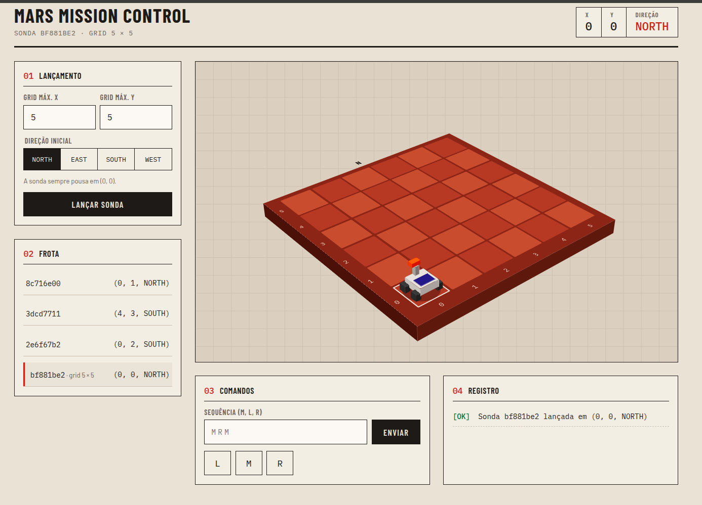

# Mars Probe Control

API para controlar sondas em um planalto de Marte, com uma interface em React para lançar sondas, enviar comandos e ver a posição de cada uma.

O backend é feito com **FastAPI** e **SQLite**, organizado em uma arquitetura **MVC simples**.



## Como funciona

O planalto é uma malha com coordenadas X e Y. A sonda sempre começa em `(0, 0)` e tem uma direção: `NORTH`, `EAST`, `SOUTH` ou `WEST`.

- No lançamento, `x` e `y` indicam o **canto superior direito** da malha. Os limites são inclusivos: com `x = 5` e `y = 5`, a malha tem 6 x 6 posições, de `(0, 0)` até `(5, 5)`.
- Comandos:
  - `M`: anda uma posição para a frente
  - `L`: gira 90° para a esquerda, sem sair do lugar
  - `R`: gira 90° para a direita, sem sair do lugar
- A sonda nunca sai da malha.
- Uma sequência é executada **inteira ou nada**. Se tiver um comando inválido, ou se algum `M` fizer a sonda sair da malha, nada é aplicado e a sonda continua onde estava.

Exemplo: uma sonda lançada em `(0, 0, NORTH)` que recebe `MRM` termina em `(1, 1, EAST)`.

## Requisitos

- Python 3.12 ou superior
- [uv](https://docs.astral.sh/uv/) para gerenciar o projeto Python
- Node.js 18 ou superior, para o front

## Como rodar

### Backend

```bash
cd backend
uv sync
uv run fastapi dev main.py
```

A API fica em http://localhost:8000 e a documentação interativa (Swagger) em http://localhost:8000/docs.

O banco SQLite é criado sozinho na primeira execução, em `backend/database/probe.db`.

### Frontend

```bash
cd web
npm install
echo "VITE_API_URL=http://localhost:8000" > .env
npm run dev
```

Abra o endereço que o Vite mostrar (normalmente http://localhost:5173).

## Testes

```bash
cd backend
uv run pytest
```

Os testes ficam em `backend/tests/` e usam um banco SQLite temporário, então não mexem no banco real.

- `test_probe_service.py`: testa as regras direto no service. Cobre o exemplo `MRM`, as rotações, os quatro limites da malha, o limite inclusivo, o tudo ou nada (sequência inválida ou que sai da malha não muda a sonda) e a sonda inexistente.
- `test_probe_api.py`: testa a API pelo HTTP. Cobre os status 200, 404 e 422 da tabela de erros e o formato das respostas.

## Endpoints

| Ação | Método e rota | Corpo da requisição |
| --- | --- | --- |
| Lançar sonda | `POST /probes` | `{ "x": 5, "y": 5, "direction": "NORTH" }` |
| Mover sonda | `POST /probes/{id}/commands` | `{ "commands": "MRM" }` |
| Listar sondas | `GET /probes` | — |

Lançar e mover respondem com a posição da sonda. Além do que o desafio pede (`id`, `x`, `y`, `direction`), a resposta traz o tamanho da malha (`grid_max_x`, `grid_max_y`), que o front usa para desenhar o planalto:

```json
{ "id": "abc123", "x": 1, "y": 1, "direction": "EAST", "grid_max_x": 5, "grid_max_y": 5 }
```

Listar responde com todas as sondas:

```json
{
  "probes": [
    { "id": "abc123", "x": 1, "y": 1, "direction": "EAST", "grid_max_x": 5, "grid_max_y": 5 },
    { "id": "xyz456", "x": 3, "y": 4, "direction": "NORTH", "grid_max_x": 8, "grid_max_y": 8 }
  ]
}
```

### Erros

Os erros trazem uma mensagem no campo `detail`.

| Situação | Status |
| --- | --- |
| Sonda não encontrada | 404 |
| Comando inválido (letra diferente de `M`, `L` ou `R`) | 422 |
| A sequência faria a sonda sair da malha | 422 |
| Tamanho de malha menor ou igual a zero | 422 |
| Direção inválida ou corpo malformado | 422 |

```json
{ "detail": "Probe cannot move out of the grid" }
```

## Arquitetura

O backend segue um MVC simples, com uma camada extra de `services` para as regras de negócio:

| Camada | Pasta | O que faz |
| --- | --- | --- |
| Model | `models/`, `database/`, `repositories/` | Os dados: schemas Pydantic, criação da tabela e acesso ao SQLite |
| View | `models/schema.py` (respostas) e `web/` | O que sai da API (JSON) e a interface em React |
| Controller | `controllers/` | Recebe a requisição HTTP e chama o service |
| Service | `services/` | Regras: validar comandos, mover, girar, não sair da malha |

O fluxo de uma requisição é sempre o mesmo:

```
requisição → controller → service → repository → SQLite
```

Os erros de regra (`exceptions.py`) são exceções próprias. O `main.py` converte cada uma no status HTTP correto, então os services não conhecem HTTP.

## Estrutura

```
mars-probe-control/
├── backend/
│   ├── main.py                    app FastAPI, CORS e tratamento de erros
│   ├── exceptions.py              erros de domínio
│   ├── controllers/
│   │   └── probe_controller.py    rotas
│   ├── services/
│   │   └── probe_service.py       regras de movimento
│   ├── repositories/
│   │   └── probe_repository.py    SQL
│   ├── models/
│   │   └── schema.py              direção, sonda e formatos de entrada e saída
│   ├── database/
│   │   └── database.py            caminho do banco e criação da tabela
│   └── tests/                     testes com pytest
├── web/                           front em React + Vite
└── render.yaml                    configuração de deploy no Render
```

## Variáveis de ambiente

| Variável | Onde | Para quê | Padrão |
| --- | --- | --- | --- |
| `DATABASE_PATH` | backend | Caminho do arquivo SQLite | `backend/database/probe.db` |
| `CORS_ORIGINS` | backend | URLs do front permitidas, separadas por vírgula | só `localhost` |
| `VITE_API_URL` | web | URL da API | `http://localhost:8000` |

## Deploy

O `render.yaml` cria dois serviços no Render: a API (`backend/`) e o front estático (`web/`). Depois de criar, defina `CORS_ORIGINS` na API com a URL do front e `VITE_API_URL` no front com a URL da API.

No plano gratuito o disco é efêmero, então o SQLite é apagado a cada deploy ou reinício.
